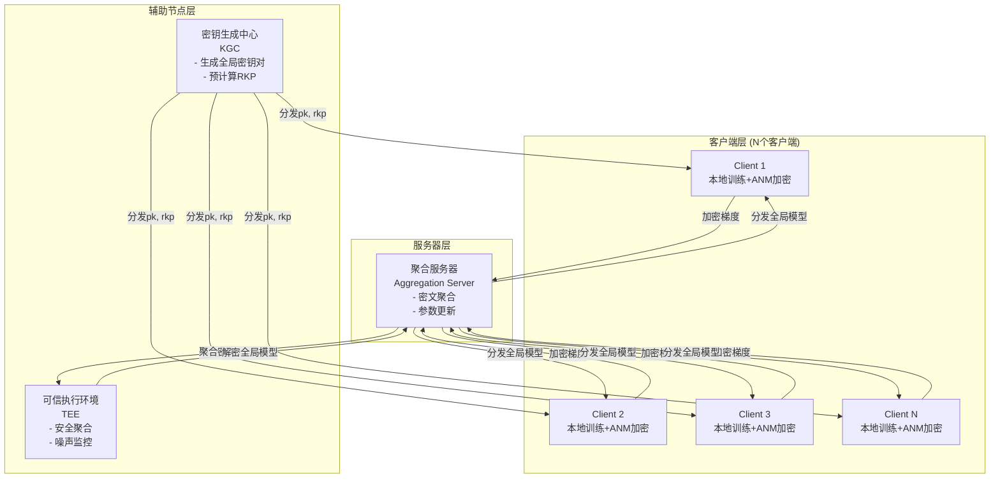
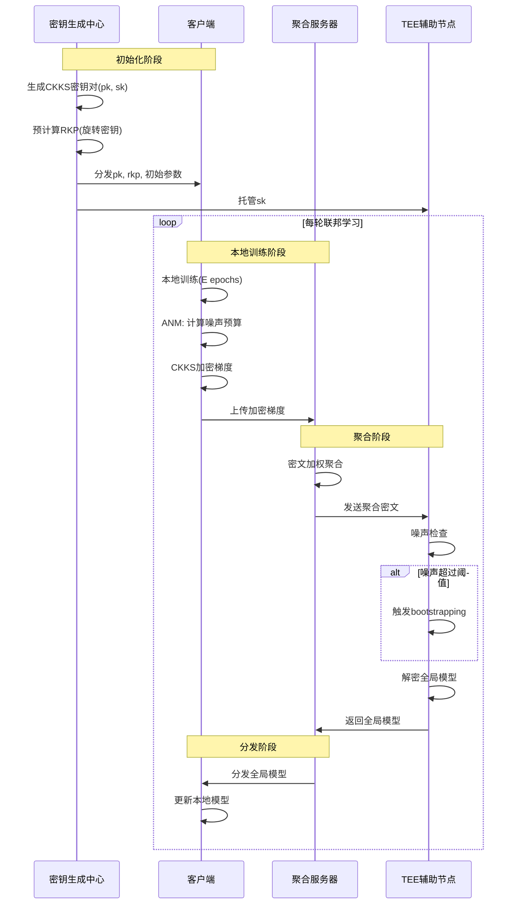

# 阶段二：CKKS-Fed 创新方案设计

## 一、方案概述

**方案名称**：CKKS-Fed: Adaptive Noise Management for Single-Key Homomorphic Encryption in Federated Learning

**核心创新点**：
1. **创新点1：噪声自适应管理策略 (Adaptive Noise Management, ANM)** —— 根据训练阶段动态调整CKKS参数，延迟bootstrapping触发
2. **创新点2：旋转密钥预分配优化 (Rotation Key Pre-distribution, RKP)** —— 基于梯度稀疏性模式预计算旋转密钥，减少在线开销

**解决的问题**：
- 现有CKKS-FL方案使用固定参数，导致早期训练阶段噪声裕量浪费，后期噪声溢出频繁
- 密文对齐操作（rotation）的密钥生成和交换开销被忽视

---

## 二、数学基础：从RLWE到CKKS

### 2.1 RLWE问题定义

**定义2.1 (Ring-LWE问题)**：
设 $R = \mathbb{Z}[X]/(X^N + 1)$ 为分圆多项式环，$R_q = R/qR$ 为模 $q$ 约化环。对于安全参数 $\lambda$，定义分布：
- $\chi_{key}$：密钥分布（通常取 $R_2$ 上的均匀分布或稀疏分布）
- $\chi_{err}$：误差分布（通常取离散高斯分布 $D_{R,\sigma}$）

**决策性RLWE问题**：区分以下两个分布：
1. 真实分布：$(a, b = a \cdot s + e) \in R_q^2$，其中 $a \leftarrow U(R_q)$, $s \leftarrow \chi_{key}$, $e \leftarrow \chi_{err}$
2. 随机分布：$(a, u) \in R_q^2$，其中 $a, u \leftarrow U(R_q)$

**定理2.2 (RLWE困难性)**：在适当参数选择下，决策性RLWE问题可量子归约到理想格上的最短向量问题(SVP)。

### 2.2 CKKS方案核心算法

**参数**：
- 环维度 $N = 2^k$（通常为1024, 2048, 4096, 8192）
- 模数链 $q_0 < q_1 < \cdots < q_L$，其中 $q_i = p_i \cdot q_{i-1}$
- 缩放因子 $\Delta = 2^p$（通常为 $2^{20}$ 到 $2^{40}$）

**算法2.3 (CKKS.KeyGen)**：
```
输入：安全参数 λ，环维度 N，模数 q_L
输出：私钥 sk，公钥 pk，评估密钥 evk

1. s ← χ_key  // 采样私钥
2. a ← U(R_{q_L})  // 均匀采样
3. e ← χ_err  // 采样误差
4. b = -a · s + e (mod q_L)  // 计算公钥分量
5. pk = (b, a)
6. evk = SwitchKeyGen(s², s)  // 生成重线性化密钥
7. 返回 (s, pk, evk)
```

**算法2.4 (CKKS.Enc)**：
```
输入：公钥 pk = (b, a)，明文 m ∈ R (编码后的向量)
输出：密文 ct = (c₀, c₁)

1. v ← χ_enc  // 加密随机性
2. e₀, e₁ ← χ_err
3. c₀ = b · v + e₀ + m (mod q_L)
4. c₁ = a · v + e₁ (mod q_L)
5. 返回 (c₀, c₁)
```

**算法2.5 (CKKS.Dec)**：
```
输入：私钥 s，密文 ct = (c₀, c₁) ∈ R_{q_l}²
输出：明文近似值 m̃

1. m̃ = c₀ + c₁ · s (mod q_l)
2. 返回 m̃
```

### 2.3 噪声分析

**定义2.6 (噪声)**：密文 $ct = (c_0, c_1)$ 加密明文 $m$ 的噪声定义为：
$$e = c_0 + c_1 \cdot s - m \pmod{q}$$

**引理2.7 (加密噪声)**：
加密后的噪声满足：
$$\|e\|_{can} \leq B_{clean} = 8\sqrt{2}\sigma N + 6\sigma\sqrt{N} + 16\sigma\sqrt{hN}$$
其中 $h$ 是私钥的汉明重量。

**引理2.8 (加法噪声增长)**：
对于两个噪声分别为 $e_1, e_2$ 的密文，加法后的噪声：
$$\|e_{add}\|_{can} \leq \|e_1\|_{can} + \|e_2\|_{can}$$

**引理2.9 (乘法噪声增长)**：
对于两个噪声分别为 $e_1, e_2$ 的密文，乘法后的噪声：
$$\|e_{mult}\|_{can} \leq C_1 \cdot \|e_1\|_{can} \cdot \|e_2\|_{can} + C_2 \cdot (\|e_1\|_{can} + \|e_2\|_{can}) + C_3$$
其中 $C_1, C_2, C_3$ 是与参数相关的常数。

**定理2.10 (噪声上界)**：
在CKKS-Fed中，经过 $k$ 轮联邦学习聚合后的噪声上界：
$$\|e^{(k)}\|_{can} \leq \Delta^{-1} \cdot q_l \cdot \left(1 - \frac{1}{n}\right)^k \cdot \|e^{(0)}\|_{can} + O(\sqrt{n})$$
其中 $n$ 是客户端数量，$\Delta$ 是缩放因子。

---

## 三、系统模型与架构

### 3.1 系统架构图



### 3.2 实体定义

| 实体 | 功能 | 信任假设 |
|------|------|----------|
| **KGC (密钥生成中心)** | 生成CKKS密钥对，预计算旋转密钥，分发密钥材料 | 半诚实，不参与后续协议 |
| **客户端 (Client)** | 本地训练，加密梯度上传，接收全局模型更新 | 可能恶意或共谋 |
| **AS (聚合服务器)** | 收集密文梯度，执行同态聚合，分发全局模型 | 半诚实 |
| **TEE (可信执行环境)** | 安全聚合解密，噪声监控，密钥托管 | 可信硬件 |

### 3.3 工作流程



---

## 四、核心创新设计

### 4.1 创新点1：噪声自适应管理 (ANM)

**核心思想**：根据训练阶段和噪声水平动态调整CKKS参数，而非使用固定参数。

**4.1.1 训练阶段划分**

| 阶段 | 轮次范围 | 特征 | ANM策略 |
|------|----------|------|---------|
| **预热期** | 0 ~ T₁ | 梯度变化大，噪声容忍度高 | 使用较小模数链，激进乘法深度 |
| **稳定期** | T₁ ~ T₂ | 梯度收敛，噪声敏感 | 使用标准模数链，保守乘法深度 |
| **精调期** | T₂ ~ T | 精细调整，噪声关键 | 使用较大模数链，最小乘法深度 |

**4.1.2 噪声预算计算**

定义**噪声预算**为：
$$\text{Budget}(ct) = \log_2(q_l) - \log_2(\|e\|_{can} \cdot \sqrt{N})$$

**算法4.1 (ANM噪声预算估计)**：
```python
def estimate_noise_budget(ciphertext, params):
    """
    估计当前密文的噪声预算
    输入: ciphertext - 当前密文
          params - CKKS参数
    输出: budget - 噪声预算(比特)
    """
    # 通过密文模数估计噪声
    q_l = ciphertext.modulus
    
    # 估计当前噪声(基于上一轮噪声和运算类型)
    if ciphertext.op_type == "add":
        estimated_noise = ciphertext.prev_noise * 2
    elif ciphertext.op_type == "mult":
        estimated_noise = ciphertext.prev_noise ** 2 * params.C_mult
    else:
        estimated_noise = ciphertext.prev_noise
    
    # 计算预算
    budget = math.log2(q_l) - math.log2(estimated_noise * math.sqrt(params.N))
    
    return budget
```

**4.1.3 自适应参数切换**

**算法4.2 (ANM参数选择)**：
```python
def select_ckks_params(round_num, noise_budget, stage_params):
    """
    根据当前轮次和噪声预算选择CKKS参数
    输入: round_num - 当前训练轮次
          noise_budget - 当前噪声预算
          stage_params - 各阶段参数配置
    输出: selected_params - 选定的CKKS参数
    """
    # 确定训练阶段
    if round_num < stage_params.T1:
        stage = "warmup"
    elif round_num < stage_params.T2:
        stage = "stable"
    else:
        stage = "finetune"
    
    # 根据噪声预算微调
    if noise_budget < stage_params.critical_threshold:
        # 噪声临界，切换到更保守的参数
        return stage_params[stage].conservative
    elif noise_budget > stage_params.safe_threshold:
        # 噪声裕量充足，可使用更激进的参数
        return stage_params[stage].aggressive
    else:
        # 标准参数
        return stage_params[stage].standard
```

**4.1.4 理论分析**

**定理4.3 (ANM噪声控制)**：
在ANM策略下，经过 $T$ 轮联邦学习后的噪声上界为：
$$\|e^{(T)}\|_{can} \leq \sum_{i=1}^{T} \alpha_i \cdot \|e^{(i-1)}\|_{can} + \beta_i$$
其中 $\alpha_i, \beta_i$ 是与第 $i$ 轮选择的CKKS参数相关的系数。

**证明概要**：
1. 基础情况：$T=0$ 时，$\|e^{(0)}\|_{can} = B_{clean}$
2. 归纳假设：假设对 $T-1$ 轮成立
3. 归纳步骤：根据第 $T$ 轮选择的参数，应用引理2.8或2.9
4. 求和得到上界

### 4.2 创新点2：旋转密钥预分配优化 (RKP)

**核心思想**：基于联邦学习中梯度稀疏性模式，预计算并分发旋转密钥，避免在线生成开销。

**4.2.1 梯度稀疏性分析**

在联邦学习中，梯度具有以下稀疏性特征：
- **结构化稀疏**：卷积层的梯度在通道维度上高度相关
- **动态稀疏**：Top-k梯度稀疏化后，非零元素位置相对集中
- **层级差异**：不同层的梯度稀疏模式不同

**4.2.2 旋转密钥需求分析**

CKKS中的旋转操作需要旋转密钥 $rk_i$，用于计算：
$$\text{Rotate}(ct, i) = (c_0, c_1) \rightarrow (c_0^{(i)}, c_1^{(i)})$$

**引理4.4 (旋转密钥数量上界)**：
对于维度为 $N$ 的CKKS密文，最多需要 $N-1$ 个不同的旋转密钥。

**定理4.5 (稀疏梯度下的RKP优化)**：
如果梯度稀疏率为 $s$（即非零元素比例为 $s$），则所需旋转密钥数量可减少至：
$$|RKP| \leq \frac{N \cdot s}{\log_2(N)} + O(1)$$

**4.2.3 RKP预计算算法**

**算法4.6 (RKP预计算)**：
```python
def precompute_rotation_keys(sk, sparse_patterns, security_param):
    """
    预计算旋转密钥
    输入: sk - CKKS私钥
          sparse_patterns - 历史梯度稀疏模式
          security_param - 安全参数
    输出: rkp - 旋转密钥池
    """
    rkp = {}
    
    # 分析稀疏模式，识别频繁旋转位置
    frequent_rotations = analyze_sparse_patterns(sparse_patterns)
    
    # 预计算这些位置的旋转密钥
    for rotation_step in frequent_rotations:
        # 生成旋转密钥
        a_rot = sample_uniform(R_q)
        e_rot = sample_gaussian(R, sigma)
        
        # 计算旋转密钥分量
        # galois_key_i = (b_i, a_i) where b_i = -a_i * s + e_i + s * X^i
        galois_elt = galois_element_for_rotation(rotation_step, N)
        b_rot = -a_rot * sk + e_rot + sk * galois_elt
        
        rkp[rotation_step] = (b_rot, a_rot)
    
    return rkp
```

**4.2.4 在线旋转优化**

**算法4.7 (RKP在线旋转)**：
```python
def optimized_rotate(ciphertext, rotation_step, rkp):
    """
    使用预计算旋转密钥执行旋转
    输入: ciphertext - 输入密文
          rotation_step - 旋转步数
          rkp - 旋转密钥池
    输出: rotated_ct - 旋转后的密文
    """
    if rotation_step in rkp:
        # 使用预计算密钥
        return apply_rotation_key(ciphertext, rkp[rotation_step])
    else:
        # 分解为多个预计算密钥的组合
        decomposed_steps = decompose_rotation(rotation_step, rkp.keys())
        result = ciphertext
        for step in decomposed_steps:
            result = apply_rotation_key(result, rkp[step])
        return result
```

---

## 五、完整协议描述

### 5.1 初始化阶段

**算法5.1 (Setup)**：
```
输入：安全参数 λ，客户端数量 n，训练轮数 T
输出：系统参数 params，密钥材料

1. // KGC执行
2. (sk, pk, evk) ← CKKS.KeyGen(λ)
3. 
4. // 分析历史梯度稀疏模式(如有)
5. sparse_patterns ← load_historical_patterns() 
6. 
7. // 预计算旋转密钥
8. rkp ← RKP.Precompute(sk, sparse_patterns, λ)
9. 
10. // 定义ANM阶段参数
11. stage_params = {
12.     T1: T // 4,        // 预热期结束
13.     T2: 3 * T // 4,    // 稳定期结束
14.     critical_threshold: 20,  // 临界噪声预算(比特)
15.     safe_threshold: 60       // 安全噪声预算(比特)
16. }
17. 
18. // 分发密钥材料
19. for each client i ∈ [n]:
20.     Send(pk, rkp, stage_params) to Client_i
21. 
22. // TEE托管私钥
23. Send(sk) to TEE
24. 
25. 返回 params = (pk, evk, rkp, stage_params)
```

### 5.2 客户端本地训练与加密

**算法5.2 (ClientLocalTrain)**：
```
输入：本地数据集 D_i，当前全局模型 w^(t)，客户端ID i
输出：加密梯度更新 Δw_i^(t)

1. // 本地训练
2. w_i ← w^(t)
3. for epoch = 1 to E:
4.     for batch in D_i:
5.         g ← ComputeGradient(batch, w_i)
6.         w_i ← w_i - η * g
7. 
8. // 计算梯度更新
9. Δw_i ← w_i - w^(t)
10. 
11. // ANM: 选择CKKS参数
12. noise_budget ← EstimateNoiseBudget(current_state)
13. ckks_params ← ANM.SelectParams(t, noise_budget, stage_params)
14. 
15. // 编码梯度
16. m_i ← CKKS.Encode(Δw_i, ckks_params)
17. 
18. // 加密梯度
19. ct_i ← CKKS.Enc(pk, m_i)
20. 
21. // 添加客户端权重信息(用于加权聚合)
22. weight_i ← |D_i| / |D_total|
23. 
24. 返回 (ct_i, weight_i)
```

### 5.3 服务器聚合

**算法5.3 (ServerAggregate)**：
```
输入：加密梯度集合 {(ct_i, weight_i)}_{i∈S_t}，当前轮次 t
输出：聚合后的全局模型更新

1. // 初始化聚合结果
2. ct_agg ← ct_1
3. total_weight ← weight_1
4. 
5. // 加权聚合(同态运算)
6. for i = 2 to |S_t|:
7.     // 标量-密文乘法: weight_i * ct_i
8.     ct_weighted ← CKKS.MultByScalar(ct_i, weight_i)
9.     
10.     // 密文加法
11.     ct_agg ← CKKS.Add(ct_agg, ct_weighted)
12.     total_weight ← total_weight + weight_i
13. 
14. // 平均化
15. ct_avg ← CKKS.MultByScalar(ct_agg, 1/total_weight)
16. 
17. // 发送到TEE解密
18. Send ct_avg to TEE
19. 
20. // 接收解密结果
21. Δw_agg ← Receive from TEE
22. 
23. 返回 Δw_agg
```

### 5.4 TEE安全聚合

**算法5.4 (TEESecureAggregate)**：
```
输入：聚合密文 ct_agg，私钥 sk，噪声阈值 θ
输出：解密后的全局模型更新

1. // 噪声检查
2. estimated_noise ← EstimateNoise(ct_agg, sk)
3. 
4. if estimated_noise > θ:
5.     // 噪声过高，执行bootstrapping
6.     ct_agg ← CKKS.Bootstrap(ct_agg, sk)
7.     Log("Bootstrapping triggered at round", t)
8. 
9. // 解密
10. m_agg ← CKKS.Dec(sk, ct_agg)
11. 
12. // 解码
13. Δw_agg ← CKKS.Decode(m_agg)
14. 
15. 返回 Δw_agg
```

---

## 六、安全性分析

### 6.1 威胁模型

**定义6.1 (威胁模型)**：

| 威胁类型 | 攻击者能力 | 防御目标 |
|----------|------------|----------|
| **半诚实攻击** | 遵循协议但试图从视图中推断额外信息 | 语义安全 |
| **恶意攻击** | 可偏离协议，发送错误消息 | 可检测性 |
| **共谋攻击** | 最多 $t < n$ 个客户端与服务器共谋 | 共谋安全 |

### 6.2 半诚实安全

**定理6.2 (半诚实安全性)**：
在半诚实威胁模型下，CKKS-Fed协议满足**语义安全**，即对于任意概率多项式时间敌手 $\mathcal{A}$，有：
$$\left| \Pr[\text{Exp}_{\mathcal{A}}^{IND}(\lambda) = 1] - \frac{1}{2} \right| \leq \text{negl}(\lambda)$$

**证明**：
1. **密钥生成安全性**：KGC生成的密钥对 $(pk, sk)$ 基于RLWE假设，满足IND-CPA安全
2. **加密安全性**：CKKS.Enc基于RLWE的加密方案，在标准模型下可证明IND-CPA安全
3. **聚合安全性**：同态聚合仅涉及密文运算，不引入额外信息泄露
4. **解密安全性**：仅TEE持有私钥，服务器无法解密单个客户端梯度

**模拟器构造**：
对于敌手 $\mathcal{A}$ 的视图 $\text{View}_{\mathcal{A}}$，构造模拟器 $\mathcal{S}$：
- $\mathcal{S}$ 生成 $(pk', sk') \leftarrow \text{CKKS.KeyGen}(\lambda)$
- 对于每个被腐蚀的客户端，$\mathcal{S}$ 使用真实输入加密
- 对于诚实客户端，$\mathcal{S}$ 使用全零向量加密（由IND-CPA安全，不可区分）

### 6.3 恶意安全

**定理6.3 (恶意攻击检测)**：
在恶意威胁模型下，CKKS-Fed可检测以下攻击：
1. **错误梯度攻击**：客户端发送错误格式的密文
2. **重复提交攻击**：同一客户端多次提交
3. **权重操纵攻击**：客户端虚报本地数据量

**检测机制**：
- 格式验证：服务器验证密文格式正确性
- 签名验证：每个客户端提交带签名的密文
- 权重审计：TEE定期审计权重分配的合理性

### 6.4 共谋安全

**定理6.4 (共谋安全性)**：
假设最多 $t < n/2$ 个客户端与服务器共谋，则：
1. 诚实客户端的梯度保持机密性
2. 聚合结果的正确性可被验证

**证明概要**：
- 共谋集合 $C$ 的大小 $|C| \leq t$
- 诚实客户端集合 $H = [n] \setminus C$ 的大小 $|H| \geq n - t > t$
- 由于TEE独立持有私钥，共谋方无法解密诚实客户端的梯度
- 聚合结果的正确性由TEE保证

### 6.5 噪声泄露分析

**引理6.5 (噪声泄露界)**：
CKKS解密泄漏的噪声信息可被用于密钥恢复攻击，但成功概率满足：
$$\Pr[\text{KeyRecovery}] \leq \frac{\|e\|_{can}}{q} + \text{negl}(\lambda)$$

**防护措施**：
1. **噪声刷新**：定期执行bootstrapping刷新噪声
2. **解密权限隔离**：仅TEE可执行解密操作
3. **访问日志审计**：记录所有解密操作

---

## 七、复杂度分析

### 7.1 计算复杂度

| 操作 | 复杂度 | 说明 |
|------|--------|------|
| CKKS.KeyGen | $O(N \log N)$ | 一次性开销 |
| CKKS.Enc | $O(N \log N)$ | 每客户端每轮 |
| CKKS.Add | $O(N)$ | 每轮聚合 |
| CKKS.MultByScalar | $O(N \log N)$ | NTT变换 |
| CKKS.Bootstrap | $O(N^2)$ | 触发时执行 |
| RKP预计算 | $O(|RKP| \cdot N \log N)$ | 一次性开销 |

### 7.2 通信复杂度

| 通信 | 复杂度 | 说明 |
|------|--------|------|
| 密钥分发 | $O(n \cdot |RKP| \cdot N \log q)$ | 初始化阶段 |
| 梯度上传 | $O(n \cdot N \log q)$ | 每轮 |
| 模型分发 | $O(n \cdot |w|)$ | 每轮(明文) |
| 旋转密钥查询 | $O(1)$ | 使用预计算密钥 |

### 7.3 与Baseline对比

| 方案 | 计算开销 | 通信开销 | 噪声控制 | 旋转密钥开销 |
|------|----------|----------|----------|--------------|
| **CKKS-Fed (本方案)** | $O(N \log N)$ | $O(nN \log q)$ | ANM自适应 | RKP预计算 |
| **BatchCrypt** | $O(N \log N)$ | $O(nN \log q)$ | 固定参数 | 在线计算 |
| **FedPHE** | $O(N^2)$ | $O(nN \log q)$ | 打包优化 | 在线计算 |
| **MaskCrypt** | $O(sN \log N)$ | $O(snN \log q)$ | 选择性加密 | 在线计算 |

其中 $s$ 是加密比例。

---

## 八、结论与阶段三准备

### 8.1 方案总结

CKKS-Fed提出了两个核心创新：
1. **ANM噪声自适应管理**：根据训练阶段动态调整CKKS参数，优化噪声预算使用
2. **RKP旋转密钥预分配**：基于梯度稀疏性预计算旋转密钥，减少在线开销

### 8.2 阶段三实现计划

阶段三将实现：
1. 基于TenSEAL的CKKS加密工具封装
2. 多客户端（≥3）本地训练+加密上传
3. 聚合服务器+TEE辅助节点
4. 9项实验指标采集与可视化

---

*设计完成时间：2026年3月30日*
