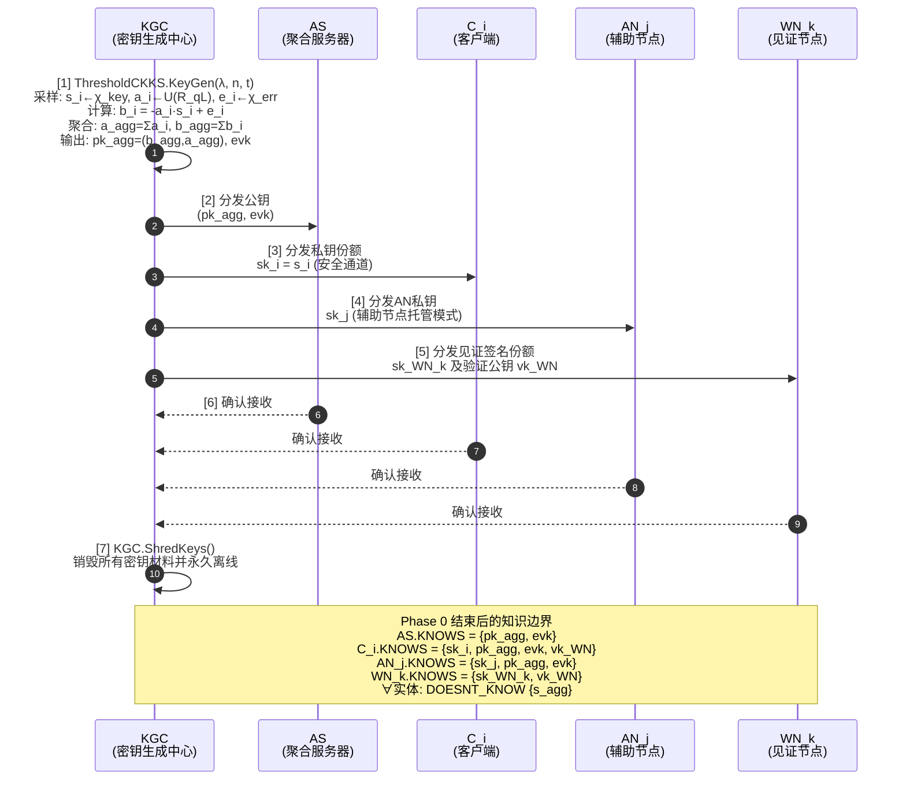
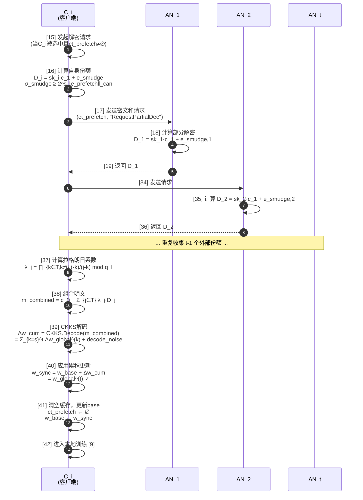
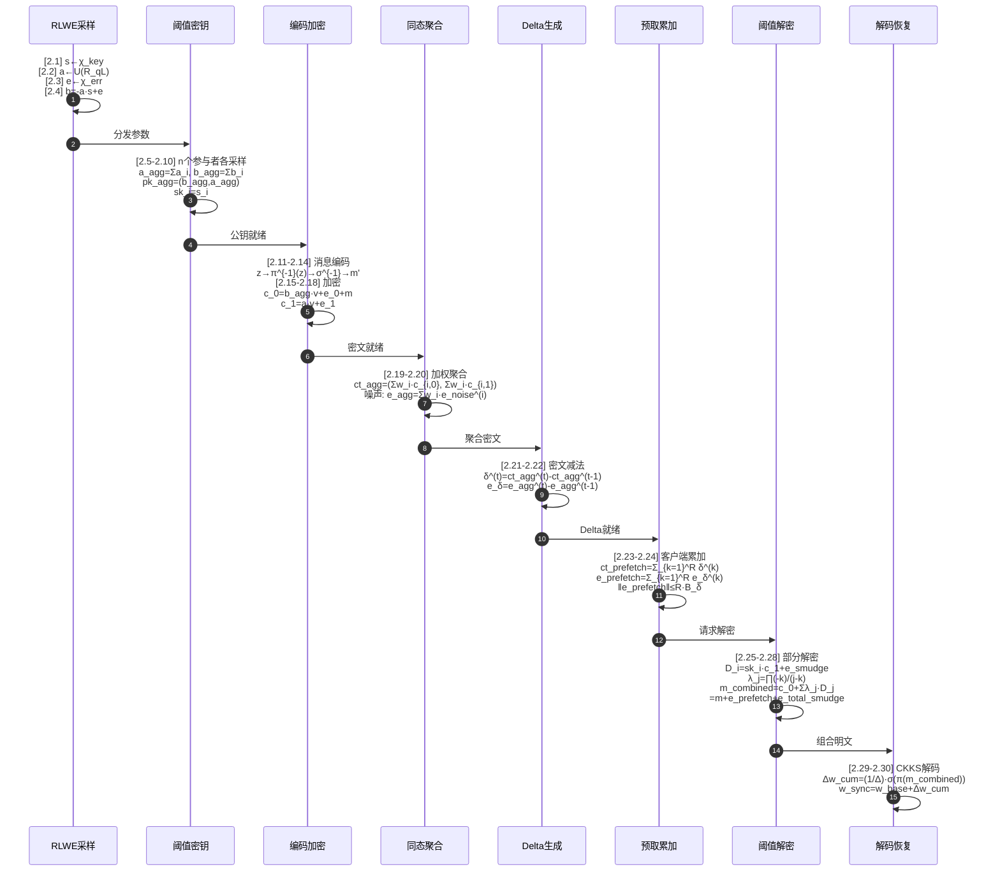
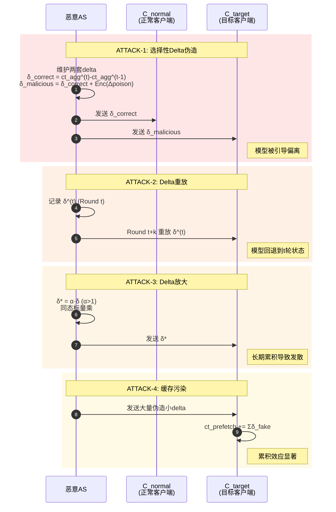
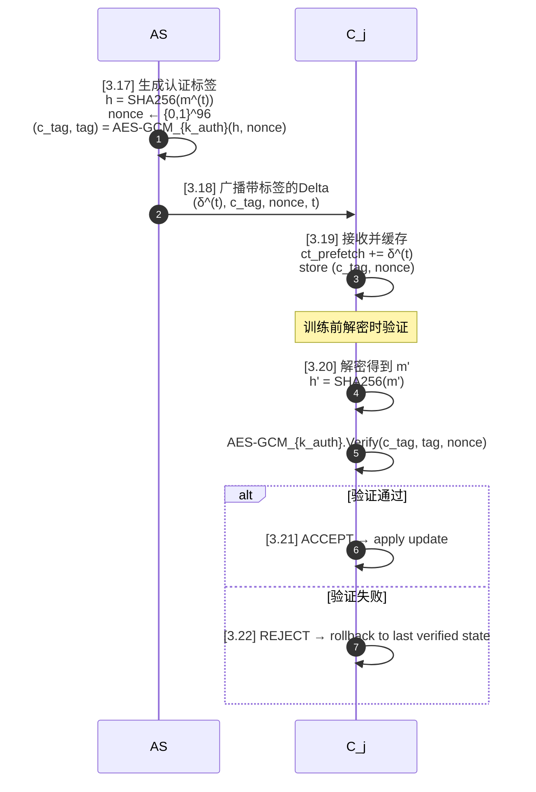
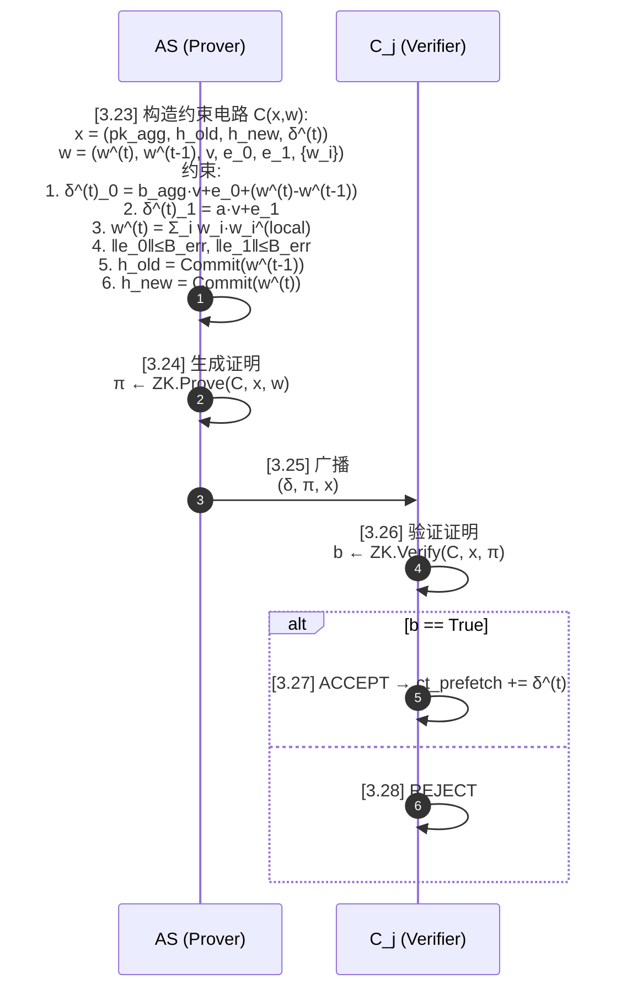
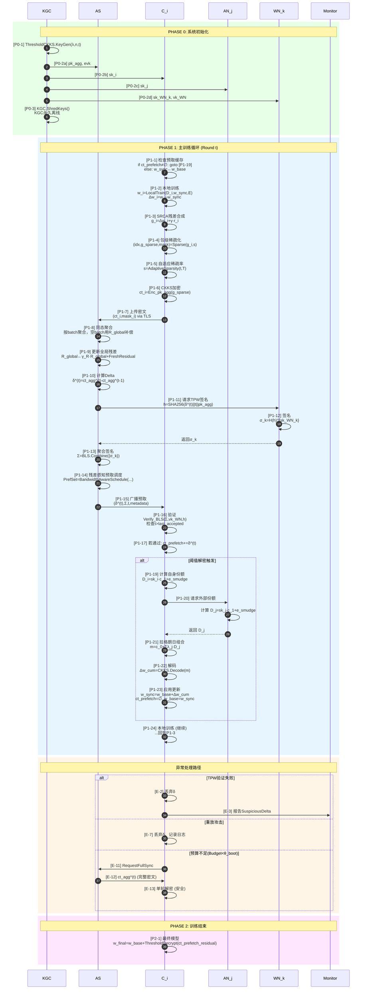
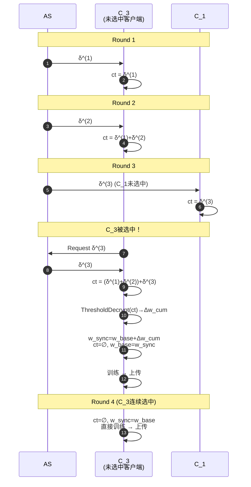

# 所有方案 Mermaid 时序图代码

> 复制以下内容到支持 Mermaid 的编辑器（如 Typora、VS Code、GitHub、Mermaid Live Editor）即可渲染图形

---

## 第一篇：Threshold-CipherFetch

### 图1.1 初始化阶段



### 图1.2 主训练循环（单轮）

```mermaid
sequenceDiagram
    autonumber
    participant AS as AS<br/>(聚合服务器)
    participant C as C_i<br/>(客户端)
    participant AN as AN_j<br/>(辅助节点)
    participant WN as WN_k<br/>(见证节点)

    rect rgb(230, 245, 255)
        Note over C: [8] 检查预取缓存<br/>if ct_prefetch ≠ ∅: 进入阈值解密<br/>else: w_sync ← w_base
    end

    C->>C: [9] 本地训练<br/>w_i ← LocalTrain(D_i, w_sync, E)<br/>Δw_i ← w_i - w_sync

    C->>C: [10] (SRCA) 残差合成<br/>g_i ← Δw_i + γ·r_i

    C->>C: [11] 包级稀疏化<br/>(idx_set, g_sparse, mask) ← SparseBatches(g_i, s)

    C->>C: [12] CKKS加密<br/>ct_i ← Enc_pk_agg(g_sparse)

    C->>AS: [13] 上传密文<br/>(ct_i, mask_i) via TLS

    AS->>AS: [14] 同态聚合<br/>for each batch b:<br/>&nbsp;&nbsp;participants ← {i | mask_i[b]=1}<br/>&nbsp;&nbsp;if |participants|>0:<br/>&nbsp;&nbsp;&nbsp;&nbsp;ct_agg[b] ← Σ w_i·ct_i[b]<br/>&nbsp;&nbsp;else:<br/>&nbsp;&nbsp;&nbsp;&nbsp;ct_agg[b] ← R_global[b]

    AS->>AS: [20] 计算密文Delta<br/>δ^(t) ← ct_agg^(t) - ct_agg^(t-1)

    AS->>WN: [21] 请求见证签名<br/>h = SHA256(δ^(t)||t||pk_agg)

    WN->>WN: [22] 生成签名<br/>σ_k = H(h)^{sk_WN_k}
    WN-->>AS: [23] 返回签名份额 σ_k

    AS->>AS: [24] 聚合签名<br/>Σ ← BLS.Combine({σ_k}, |T|=t_w)

    AS->>AS: [25] 预取调度<br/>PrefSet ← SelectClients(bandwidth_budget)

    AS->>C: [26] 广播预取Delta<br/>(δ^(t), Σ, t, metadata)

    C->>C: [27] 接收并验证<br/>Verify_BLS(Σ, vk_WN, h)<br/>检查 t > last_accepted_round

    alt 验证通过且t最新
        C->>C: [28] ct_prefetch += δ^(t)<br/>last_accepted ← t
    else 重放攻击
        C->>C: [29] REJECT_REPLAY
    else 签名伪造
        C->>C: [30] REJECT_FORGERY
    end

    C->>AS: [31] 选中客户端上传更新<br/>(对未使用预取的选中客户端)

    AS->>AS: [32] 更新全局模型<br/>w_global^(t) ← w_global^(t-1) + Decrypt(ct_agg)

    AS->>AS: [33] 准备下一轮<br/>ct_agg_prev ← ct_agg^(t)
```

### 图1.3 阈值解密子流程



---

## 第二篇：公式闭环噪声递推

### 图2.1 完整公式链



---

## 第三篇：安全防御方案

### 图3.1 攻击向量全景



### 图3.2 TPW防御

```mermaid
sequenceDiagram
    autonumber
    participant AS as AS
    participant W1 as WN_1
    participant W2 as WN_2
    participant Wt as WN_tw
    participant C as C_j

    AS->>AS: [3.1] 生成Delta后请求签名<br/>h = SHA256(δ^(t).serialize()||t||τ||pk_agg)

    AS->>W1: [3.2] 发送哈希<br/>("SignRequest", h, t)
    W1->>W1: [3.3] 验证并签名<br/>if t > last_signed_round[AS]:<br/>&nbsp;&nbsp;σ_1 = H(h)^{sk_WN_1}<br/>else: REJECT
    W1-->>AS: [3.4] 返回 σ_1

    AS->>W2: [3.5] 发送哈希
    W2->>W2: [3.6] 签名 σ_2 = H(h)^{sk_WN_2}
    W2-->>AS: [3.7] 返回 σ_2

    Note over AS,Wt: ... 重复至收集 t_w 个签名 ...

    AS->>Wt: [3.8] 发送哈希
    Wt->>Wt: [3.9] 签名 σ_tw = H(h)^{sk_WN_tw}
    Wt-->>AS: [3.10] 返回 σ_tw

    AS->>AS: [3.11] 聚合签名<br/>Σ = ∏_{k∈T} σ_k^{λ_k} = H(h)^x

    AS->>C: [3.12] 广播带签名的Delta<br/>(δ^(t), Σ, t, τ)

    C->>C: [3.13] 验证<br/>h' = SHA256(δ^(t)||t||τ||pk_agg)<br/>e(Σ,g_2) == e(H(h'),PK)?<br/>t > last_accepted_round?

    alt 验证通过且t最新
        C->>C: [3.14] ACCEPT → ct_prefetch += δ^(t)
    else 重放
        C->>C: [3.15] REJECT_REPLAY
    else 伪造
        C->>C: [3.16] REJECT_FORGERY
    end
```

### 图3.3 ACD认证



### 图3.4 ZKPP零知识证明



---

## 第四篇：SRCA通信优化

### 图4.1 客户端残差累积

```mermaid
sequenceDiagram
    autonumber
    participant C as C_i<br/>SRCA客户端

    C->>C: [4.1] 初始化<br/>r_i^(0) = 0

    loop 每轮训练
        C->>C: [4.2] 输入 raw_gradient Δw_i^(t)

        C->>C: [4.3] 残差合成<br/>g_i^(t) = Δw_i^(t) + γ·r_i^(t-1)

        C->>C: [4.4] 包级稀疏化<br/>(idx, g_sparse, mask) = SparseBatches(g_i^(t), s)

        C->>C: [4.5] CKKS加密<br/>ct_i^(t) = Enc_pk_agg(g_sparse)

        C->>C: [4.6] 残差更新<br/>for each batch b:<br/>&nbsp;&nbsp;if mask[b]==1: r_i^(t)[b]=0<br/>&nbsp;&nbsp;else: r_i^(t)[b]=g_i^(t)[b]

        C->>C: [4.7] 衰减 (可选)<br/>r_i^(t) = γ·r_i^(t)
    end

    C->>C: [4.8] 输出 ct_i^(t), r_i^(t)
```

### 图4.2 服务器聚合与残差补偿

```mermaid
sequenceDiagram
    autonumber
    participant AS as AS<br/>SRCA服务器
    participant C as C_j

    AS->>AS: [4.9] 输入 {(ct_i, mask_i)}_{i∈S_t}

    AS->>AS: [4.10] 按batch分桶聚合<br/>for each batch b:<br/>&nbsp;&nbsp;participants = {i | mask_i[b]=1}

    alt |participants| > 0
        AS->>AS: [4.11] 正常聚合<br/>ct_agg[b] = WeightedAvg({ct_i[b]}, {w_i})
    else
        AS->>AS: [4.12] 全局残差补偿<br/>ct_agg[b] = R_global^(t-1)[b]
    end

    AS->>AS: [4.13] 更新全局残差<br/>for each batch b:<br/>&nbsp;&nbsp;if |participants|==0:<br/>&nbsp;&nbsp;&nbsp;&nbsp;R_global[b] = γ_R·R_global[b] + FreshResidual<br/>&nbsp;&nbsp;else:<br/>&nbsp;&nbsp;&nbsp;&nbsp;R_global[b] = γ_R·R_global[b]

    AS->>AS: [4.14] 生成Delta<br/>δ^(t) = ct_agg^(t) - ct_agg^(t-1)

    AS->>AS: [4.15] 残差感知预取调度<br/>for j∉S_t:<br/>&nbsp;&nbsp;priority[j] = α·‖r_j‖ + (1-α)·feasible[j]

    AS->>AS: [4.16] PrefSet = TopK(priority, budget)

    AS->>C: [4.17] 广播预取<br/>for j in PrefSet: AS→C_j: δ^(t)
```

---

## 融合方案：SecureRes-Fetch 总流程

### 图5.1 端到端完整流程



### 图5.2 多轮预取累积示例


```

---

*使用方法：将上述代码块中的内容复制到 [Mermaid Live Editor](https://mermaid.live) 或任何支持 Mermaid 的 Markdown 渲染器中即可看到渲染后的时序图。*
