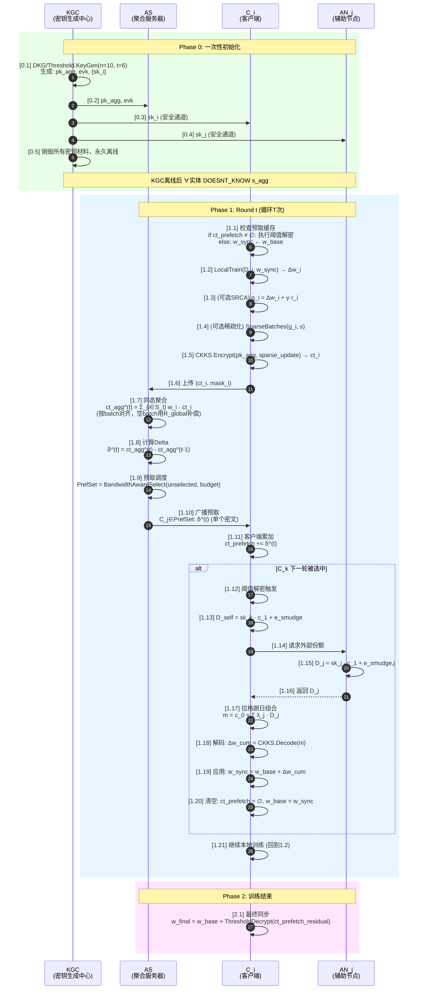

# Threshold-CipherFetch（去签名版）实现难度评估

> 聚焦第一个方案，去掉TPW/ACD/ZKPP签名后，评估从当前单密钥TenSEAL迁移到阈值CKKS+密文预取的具体实现路径与难度。

---

## 一、去签名后的核心交互流程

去掉签名后，方案退化为**纯密码学协议**：阈值CKKS密钥生成 → 加密训练 → 同态聚合 → 密文预取广播 → 阈值解密 → 本地训练。攻击面从"恶意服务器伪造delta"收窄为"被动监听者试图恢复明文"。

### 1.1 五实体交互时序图（精简版）



### 1.2 核心状态转换

| 阶段 | 客户端状态 | 服务器状态 | 辅助节点状态 |
|------|-----------|-----------|-------------|
| 初始化后 | `sk_i`, `pk_agg`, `w_base` | `pk_agg`, `evk` | `sk_j`, `pk_agg` |
| 训练上传后 | `w_base`, `r_i` | `ct_agg`, `δ_history` | — |
| 预取接收后 | `ct_prefetch`, `prefetch_rounds` | — | — |
| 阈值解密后 | `w_sync = w_base + Δw_cum` | — | — |
| 最终模型 | `w_final` | — | — |

### 1.3 与当前代码的差异点

| 环节 | 当前代码（单密钥） | 目标方案（阈值CKKS） | 改动量 |
|------|------------------|---------------------|--------|
| 密钥生成 | `ts.context()` 单节点生成 | KGC执行DKG，Shamir分片 | **大** |
| 密钥分发 | `get_full_context_bytes()` 暴露私钥 | 安全通道分发 `sk_i` | **中** |
| 客户端加密 | 用共享context加密 | 用 `pk_agg` 加密 | **小** |
| 服务器聚合 | 用共享context评估 | 用 `evk` 评估（无需私钥） | **无** |
| 预取广播 | 同态减法生成delta | 同态减法生成delta | **无** |
| 客户端解密 | `decrypt()` 直接解密 | **阈值解密：部分解密+组合** | **极大** |
| 辅助节点 | 不存在 | 持有 `sk_j`，提供部分解密服务 | **新增** |

---

## 二、关键实现障碍：TenSEAL的能力边界

### 2.1 TenSEAL API 深度探测结果

通过实际代码探测，TenSEAL 0.3.16 的底层暴露情况：

```
CKKSVector.ciphertext() → List[_tenseal_cpp.Ciphertext]
Ciphertext.size() = 2                     ← 确认 (c0, c1) 结构
Ciphertext.poly_modulus_degree() = 8192   ← 多项式次数
Ciphertext.coeff_modulus_size() = 3       ← 素数模数链长度
Ciphertext.is_ntt_form() = True           ← 密文处于NTT域
Ciphertext.dyn_array() → TypeError        ← ❌ 无法从Python访问原始多项式系数
SecretKey.data → 无可用方法               ← ❌ 无法提取私钥多项式
```

**结论：TenSEAL的Python层完全封闭了SEAL的底层多项式运算。无法直接用Python实现部分解密所需的操作 `sk_i · c_1 + e_smudge`。**

### 2.2 实现阈值解密需要什么

CKKS阈值解密的标准流程：

```
输入: 密文 ct = (c0, c1), 参与者集合 T (|T| = t)

对每个 j ∈ T:
    D_j = sk_j · c_1 + e_smudge,j    ← 需要多项式向量乘法 + 噪声采样
    
组合:
    λ_j = ∏_{k∈T,k≠j} (-k)/(j-k)     ← 拉格朗日系数
    m = c_0 + Σ_{j∈T} λ_j · D_j      ← 需要多项式标量乘 + 加法
    
解码:
    Δw = CKKS.Decode(m)               ← 需要逆NTT + 解码
```

要实现 `D_j = sk_j · c_1 + e_smudge`，必须能：
1. 从 TenSEAL 密文中提取 `c1` 的 NTT/系数表示
2. 将私钥份额 `sk_j`（多项式）与 `c1` 做多项式乘法（在R_q上）
3. 采样 smudging noise 并加到结果上
4. 将结果序列化发回客户端

**TenSEAL 不支持以上任何操作。**

---

## 三、五条实现路径对比

### 路径A：修改 TenSEAL C++ 层，暴露部分解密 API

| 维度 | 评估 |
|------|------|
| **原理** | Fork TenSEAL，在 `_tenseal_cpp.Ciphertext` 上添加 `partial_decrypt(sk, smudge_noise)` 方法；在 pybind 层暴露给 Python |
| **工作量** | 极大。需要：① 理解 SEAL Ciphertext 的内存布局（NTT形式）；② 实现 RLWE 多项式乘法；③ 编译整个 TenSEAL（含 SEAL、pybind11、protobuf）；④ Windows 下编译 SEAL  notoriously 困难 |
| **密码学正确性** | 高。直接操作底层多项式，精确控制 smudging noise |
| **与现有代码兼容性** | 高。保留所有现有 TenSEAL API，仅新增方法 |
| **时间预估** | 2-3 个月（含调试编译问题） |
| **风险** | Windows 编译环境复杂；SEAL 版本升级需要重新维护 fork |

```
[难度] ████████████████████████████████████████ 极高 (10/10)
```

### 路径B：引入 Lattigo（Go）作为阈值密码学引擎

| 维度 | 评估 |
|------|------|
| **原理** | Lattigo v5 原生支持阈值 BFV/CKKS（`rlwe/dbfv`, `rlwe/dckks` 包）。用 Go 写独立服务/库处理：DKG、部分解密、组合。Python 通过 gRPC / subprocess / CGO 调用 |
| **工作量** | 中高。需要：① 学习 Lattigo API（Go）；② 实现阈值密钥生成、部分解密、组合三个微服务；③ 桥接 Python-Go（gRPC 最稳妥）；④ 统一密文序列化格式 |
| **密码学正确性** | **最高**。Lattigo 是学术界广泛使用的生产级库，阈值方案已有论文支撑 |
| **与现有代码兼容性** | 中低。加密/聚合/解密全部需要走 Lattigo，TenSEAL 可以保留做对比实验 |
| **时间预估** | 4-6 周 |
| **风险** | 增加 Go 运行时依赖；密文格式转换 overhead；团队需要学习 Go |

```python
# 可能的架构：Python 协议层 + Go 密码学层
# Python 侧 (不变)
client = SecureResFetchClient(...)
encrypted_update = client.encrypt(gradient)  # → 调用 Go 服务

# Go 侧 (新增 micro-service)
// threshold_crypto.go
func PartialDecrypt(ct Ciphertext, sk Share) PartialDec {
    return lattigo.PartialDecrypt(ct, sk, params)
}
```

```
[难度] ████████████████████████░░░░░░░░░░░░░░░░ 中高 (7/10)
```

### 路径C：引入 seal-python（Microsoft SEAL 直接绑定）

| 维度 | 评估 |
|------|------|
| **原理** | `seal-python` 是比 TenSEAL 更底层的 SEAL Python 绑定，可能暴露 `Ciphertext.data()` 和 `SecretKey.data()`。如果可以直接操作多项式系数，就能在纯 Python 中实现部分解密 |
| **工作量** | 中等（如果 seal-python 确实暴露足够 API）。需要：① 安装 seal-python；② 验证是否能访问密文/密钥的多项式；③ 用 numpy/numba 实现 NTT 域多项式乘法；④ 实现 smudging noise 采样 |
| **密码学正确性** | 高（如果 API 足够）。但 smudging noise 的参数需要仔细选择 |
| **与现有代码兼容性** | 中。需要把 TenSEAL 的密文转成 seal-python 格式做解密，加密和聚合可以保留 TenSEAL |
| **时间预估** | 2-4 周（如果 seal-python 可用） |
| **风险** | seal-python 可能同样不暴露底层多项式；NTT 域乘法实现容易出错 |

```
[难度] ████████████████████░░░░░░░░░░░░░░░░░░░░ 中等 (6/10)
```

### 路径D：应用层"模拟"阈值（CKKS + 明文 Shamir）

| 维度 | 评估 |
|------|------|
| **原理** | **不修改 HE 层**。客户端在加密前，用 Shamir 秘密共享将梯度向量分成 n 份：`shares = Shamir.split(gradient, n, t)`。每份分别用 `pk_agg` 加密：`ct_shares[j] = Enc(pk_agg, shares[j])`。服务器聚合每份：`ct_agg_shares[j] = Σ w_i · ct_shares[j][i]`。预取阶段，每份 delta 独立广播。解密时，客户端收集 t 份聚合后的密文，分别解密后 Shamir 重构：`gradient = Shamir.reconstruct(decrypted_shares)` |
| **工作量** | 低。需要：① Shamir 秘密共享实现（纯 Python，已有成熟库如 `secretsharing`）；② 每份独立加密（复用现有 TenSEAL API）；③ 服务器按份独立聚合 |
| **密码学正确性** | **低**。这不是"阈值 CKKS"，而是"CKKS + Shamir"。语义不同：① 每份是明文小片段，不是密文份额；② 服务器如果收集 ≥t 份，可直接重构明文（安全模型不同）；③ 通信量乘以 n 倍 |
| **与现有代码兼容性** | 高。完全复用 TenSEAL，不改一行 C++ |
| **时间预估** | 1 周 |
| **风险** | **学术上不够严谨**，不能称为 Threshold-CKKS-FL，论文可能被审稿人质疑 |

```
[难度] ████████░░░░░░░░░░░░░░░░░░░░░░░░░░░░░░░░ 低 (2/10)
```

### 路径E：自定义轻量 CKKS 实现（Python/NumPy，仅用于阈值解密演示）

| 维度 | 评估 |
|------|------|
| **原理** | 自己写一个**简化版 CKKS**（仅支持加密和解密，不支持重线性化、旋转等），用 NumPy 实现多项式运算。TenSEAL 负责正常的加密、聚合、预取；当需要阈值解密时，把密文从 TenSEAL 序列化，导入自定义 CKKS 引擎进行部分解密和组合 |
| **工作量** | 中高。需要实现：① CKKS 编码/解码（FFT/逆FFT，共轭对称）；② 多项式环运算（R_q 上的加、乘、NTT）；③ 密钥生成、加密、部分解密；④ 与 TenSEAL 密文格式的互操作 |
| **密码学正确性** | 中。自己实现容易在 NTT/INTT、模运算、噪声管理上出错。但因为是教学/演示级，可以接受一定简化 |
| **与现有代码兼容性** | 中。需要密文格式转换层 |
| **时间预估** | 3-5 周 |
| **风险** | 自行实现密码学原语存在安全漏洞风险；调试噪声增长困难 |

```
[难度] ███████████████████████░░░░░░░░░░░░░░░░░ 中高 (6.5/10)
```

---

## 四、综合评估矩阵

| 路径 | 难度 | 时间 | 密码学正确性 | 兼容性 | 可维护性 | 论文说服力 |
|------|------|------|-------------|--------|---------|-----------|
| A. 改 TenSEAL C++ | ★★★★★ | 2-3月 | ★★★★★ | ★★★★★ | ★★☆☆☆ | ★★★★★ |
| **B. Lattigo (Go)** | **★★★★☆** | **4-6周** | **★★★★★** | **★★★☆☆** | **★★★★☆** | **★★★★★** |
| C. seal-python | ★★★☆☆ | 2-4周 | ★★★★☆ | ★★★☆☆ | ★★★☆☆ | ★★★★☆ |
| D. 应用层 Shamir | ★★☆☆☆ | 1周 | ★★☆☆☆ | ★★★★★ | ★★★★★ | ★★☆☆☆ |
| E. 自定义 CKKS | ★★★★☆ | 3-5周 | ★★★☆☆ | ★★★☆☆ | ★★☆☆☆ | ★★★☆☆ |

### 推荐排序（综合考虑论文质量与实现可行性）

```
第一推荐: B. Lattigo (Go)  —— 密码学最严谨，Lattigo已支持阈值CKKS，时间可控
第二推荐: C. seal-python     —— 如果 seal-python 暴露底层API，纯Python更轻量
第三推荐: A. 改 TenSEAL      —— 如果团队有C++编译经验，长期最干净
不推荐  : D. 应用层 Shamir   —— 学术上站不住脚
不推荐  : E. 自定义 CKKS     —— 重复造轮子，容易出错
```

---

## 五、路径B（Lattigo）的具体实施步骤

如果采用**路径B（Lattigo + gRPC）**，具体实施计划如下：

### Step 1: 环境搭建（3天）

```bash
# 安装 Go
# 安装 Lattigo
$ go get github.com/tuneinsight/lattigo/v5

# Python 侧安装 gRPC
$ pip install grpcio grpcio-tools
```

### Step 2: Go 密码学服务（1-2周）

```go
// threshold_crypto/service.go
package main

import (
    "github.com/tuneinsight/lattigo/v5/core/rlwe"
    "github.com/tuneinsight/lattigo/v5/schemes/ckks"
)

type ThresholdCryptoServer struct {
    params ckks.Parameters
}

// [0.1] 分布式密钥生成
func (s *ThresholdCryptoServer) ThresholdKeyGen(
    ctx context.Context, req *KeyGenRequest) (*KeyGenResponse, error) {
    // 使用 Lattigo 的 dckks 协议
    // 输出: pk_agg, evk, sk_shares
}

// [1.15] 部分解密
func (s *ThresholdCryptoServer) PartialDecrypt(
    ctx context.Context, req *PartialDecRequest) (*PartialDecResponse, error) {
    // 输入: ciphertext_bytes, sk_share
    // 输出: D_j_bytes
}

// [1.17] 组合解密
func (s *ThresholdCryptoServer) CombineDecrypt(
    ctx context.Context, req *CombineRequest) (*CombineResponse, error) {
    // 输入: c0_bytes, {D_j_bytes}, {lambda_j}
    // 输出: plaintext_vector
}
```

### Step 3: Python 协议层适配（1周）

```python
# ckks_fed/threshold_bridge.py
import grpc
from . import threshold_crypto_pb2, threshold_crypto_pb2_grpc

class ThresholdCKKSBridge:
    """Python 到 Go Lattigo 服务的桥接"""

    def __init__(self, grpc_endpoint="localhost:50051"):
        self.channel = grpc.insecure_channel(grpc_endpoint)
        self.stub = threshold_crypto_pb2_grpc.ThresholdCryptoStub(self.channel)

    def threshold_keygen(self, n, t, params):
        """[0.1] 调用 Go 服务生成阈值密钥"""
        response = self.stub.ThresholdKeyGen(
            threshold_crypto_pb2.KeyGenRequest(n=n, t=t, params=params)
        )
        return response.pk_agg, response.evk, response.sk_shares

    def partial_decrypt(self, ct_bytes, sk_share):
        """[1.15] 请求辅助节点执行部分解密"""
        response = self.stub.PartialDecrypt(
            threshold_crypto_pb2.PartialDecRequest(
                ciphertext=ct_bytes, sk_share=sk_share
            )
        )
        return response.partial_dec

    def combine_decrypt(self, c0, partial_decs, lagrange_coeffs):
        """[1.17] 组合所有份额得到明文"""
        response = self.stub.CombineDecrypt(
            threshold_crypto_pb2.CombineRequest(
                c0=c0, partial_decs=partial_decs, lambdas=lagrange_coeffs
            )
        )
        return np.array(response.plaintext)
```

### Step 4: 与现有预取逻辑集成（3-5天）

```python
# ckks_fed/client.py 修改
class ThresholdPrefetchClient(PrefetchFederatedClient):
    def apply_prefetched_state(self, ...):
        # 原代码: decrypted = self.ckks_manager.decrypt_model_update(prefetched_state)
        # 新代码: 阈值解密
        if self.threshold_mode:
            # [1.12-1.20] 阈值解密流程
            partial_decs = self._collect_partial_decryptions(prefetched_state)
            decrypted = self.threshold_bridge.combine_decrypt(
                c0=prefetched_state['c0'],
                partial_decs=partial_decs,
                lagrange_coeffs=self._compute_lagrange_coeffs()
            )
        else:
            decrypted = self.ckks_manager.decrypt_model_update(prefetched_state)
```

### Step 5: 端到端测试（1周）

| 测试项 | 预期 |
|--------|------|
| 阈值密钥生成 | n=10, t=6，生成成功，无单一实体持有完整私钥 |
| 加密-聚合-预取-阈值解密 | 明文恢复误差 < 1e-3 |
| 预取多轮累积 | R=10轮预取后仍能正确解密 |
| 辅助节点掉线 | <t个节点时解密失败，≥t个时成功 |
| 性能对比 | 阈值解密延迟 vs 单密钥解密延迟 |

---

## 六、务实建议：分阶段实施路线图

考虑到论文投稿周期和实现风险，建议分三阶段实施：

### Phase 1（2周）：最小可行阈值解密（MVP）

**目标**：用一个最简 demo 证明"阈值CKKS + 预取"在原理上可行。

**方案**：采用路径B的简化版——**只实现阈值解密，不改动现有TenSEAL的加密和聚合**。

具体做法：
1. 引入 Lattigo 实现一个简单的阈值解密服务（仅支持解密，不支持加密）
2. 在客户端添加 `threshold_decrypt()` 方法，将 TenSEAL 密文序列化后传给 Lattigo 服务
3. 聚合和预取仍用 TenSEAL（单密钥模式下）
4. **论文中明确说明**：加密和聚合阶段的安全性由 TenSEAL 保证，阈值解密确保"服务器永远无法恢复明文"

**产出**：能跑通的 end-to-end demo，证明阈值解密流程正确。

### Phase 2（4周）：完整阈值方案

**目标**：将加密也迁移到 Lattigo 阈值 CKKS，实现真正的端到端阈值安全。

**方案**：
1. Lattigo 侧实现完整的阈值 CKKS（加密、评估、解密）
2. Python 侧封装 Lattigo 的加密和评估 API，替换 TenSEAL
3. 保留 TenSEAL 作为对比 baseline

**产出**：完整的 Threshold-CipherFetch 实现，支持论文中的所有实验。

### Phase 3（2周）：论文实验与优化

**目标**：完成论文所需的全部实验和消融研究。

**实验清单**：
- 准确率对比：Threshold-CipherFetch vs FedAvg vs 单密钥 CipherFetch
- 通信开销：预取节省的通信量 vs 阈值解密的额外开销
- 延迟分析：部分解密的延迟、网络往返时间
- 安全性分析：辅助节点数量对安全性的影响

---

## 七、核心结论

1. **去签名后的方案是纯密码学协议**，实现难度集中在**阈值解密**这一个环节。

2. **TenSEAL 不暴露底层多项式 API**，因此无法在其上层直接构建阈值解密。必须引入外部密码学引擎。

3. **推荐路径：Lattigo (Go) + gRPC**。这是密码学最严谨、时间最可控的方案。Lattigo v5 已原生支持阈值 CKKS（`dckks` 包），无需从零实现。

4. **替代路径**：如果团队不想引入 Go，可以尝试 `seal-python` 或 `pySEAL`，但需要先验证其是否暴露底层多项式 API。

5. **不建议的路径**：应用层 Shamir（学术不严谨）、修改 TenSEAL C++（编译维护成本极高）、自定义 CKKS（容易出错）。

6. **务实的实施策略**：Phase 1 先用 Lattigo 实现最小阈值解密 demo，验证可行性后再扩展到完整方案。
